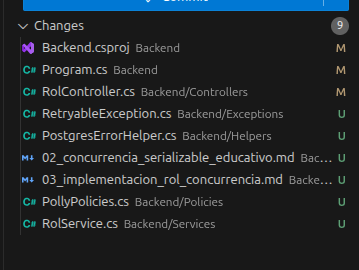

# 🔒 Guía Educativa: Concurrencia con PostgreSQL y Entity Framework Core

## ¿Qué problema resolvemos?

Imagina que dos administradores abren la pantalla de roles al mismo tiempo y ambos intentan crear un rol llamado "Supervisor". Sin control de concurrencia, ambas peticiones pueden pasar la validación de nombre duplicado (porque ambas leen la BD **antes** de que la otra haya insertado) y una de ellas explotará con un error feo de la base de datos.

Este es un problema de **condición de carrera** (race condition), y la solución es usar **transacciones con nivel de aislamiento adecuado**.

---

## Conceptos clave

### 1. ¿Qué es una Transacción?

Una transacción es un grupo de operaciones que se ejecutan como **una sola unidad**:
- Si **todas** las operaciones tienen éxito → se aplican (COMMIT).
- Si **alguna** falla → se deshacen todas (ROLLBACK).

```
BEGIN TRANSACTION
  ├── SELECT: ¿Existe un rol "Supervisor"? → No
  ├── INSERT: Crear rol "Supervisor"
  └── COMMIT ← Todo se guarda
```

### 2. ¿Qué es el Nivel de Aislamiento?

Define **cuánto "ve" una transacción de los cambios que hacen otras transacciones concurrentes**. PostgreSQL soporta 4 niveles:

| Nivel | ¿Qué ve? | ¿Cuándo usarlo? |
|-------|----------|-----------------|
| **READ UNCOMMITTED** | Datos sin confirmar de otros | ⚠️ Casi nunca (PostgreSQL lo trata como READ COMMITTED) |
| **READ COMMITTED** | Solo datos confirmados (por cada sentencia) | ✅ Lecturas normales (catálogos, listas) |
| **REPEATABLE READ** | Foto fija desde el inicio de la transacción | Reportes que necesitan consistencia |
| **SERIALIZABLE** | Como si las transacciones corrieran una tras otra | ✅ Escrituras críticas donde importa la integridad |

### 3. ¿Qué es MVCC? (Multi-Version Concurrency Control)

PostgreSQL NO bloquea filas para leer. En su lugar, mantiene **múltiples versiones** de cada fila:

```
Versión 1: { id: 1, nombre: "Admin" }        ← visible para Txn A
Versión 2: { id: 1, nombre: "Administrador" } ← visible para Txn B (que hizo UPDATE)
```

Esto permite que:
- **Lectores NO bloquean a escritores** → Las consultas SELECT nunca esperan.
- **Escritores NO bloquean a lectores** → Los INSERT/UPDATE nunca frenan las lecturas.

Por eso READ COMMITTED es perfecto para lecturas: aprovecha MVCC al máximo y no agrega overhead.

### 4. ¿Qué pasa con SERIALIZABLE y el error 40001?

Cuando usamos SERIALIZABLE, PostgreSQL vigila que el resultado sea **idéntico** a si las transacciones hubieran corrido en secuencia. Si detecta un conflicto, **aborta** una de las transacciones con:

```
ERROR: could not serialize access due to concurrent update
SQLSTATE: 40001 (serialization_failure)
```

**Esto NO es un bug, es el comportamiento esperado.** PostgreSQL nos dice: "No puedo garantizar la integridad, cancelo esta transacción, inténtalo de nuevo."

Nuestro trabajo es **detectar ese error y reintentar automáticamente**.

---

## La Estrategia Implementada

### Para lecturas (GET): READ COMMITTED

```csharp
// Sin transacción explícita, sin bloqueos
// AsNoTracking() = solo lectura, más eficiente
var roles = await ctx.Roles
    .AsNoTracking()
    .Select(r => new RolResponse(r.Id, r.Nombre, r.Descripcion))
    .ToListAsync();
```

**¿Por qué?**
- Listar roles no necesita garantías extremas.
- Si otro usuario crea un rol mientras lees, lo verás en la siguiente consulta.
- `AsNoTracking()` le dice a EF Core: "no necesito rastrear cambios en estas entidades", lo cual consume menos memoria.

### Para escrituras (POST, PUT, DELETE): SERIALIZABLE + Reintentos

```csharp
// Transacción SERIALIZABLE
await using var tx = await ctx.Database
    .BeginTransactionAsync(IsolationLevel.Serializable);

// ... lógica de negocio ...

await ctx.SaveChangesAsync();
await tx.CommitAsync();
```

Si falla con 40001, se hace rollback y Polly lo reintenta automáticamente.

---

## ¿Qué es Polly y por qué usamos Backoff Exponencial?

**Polly** es una librería .NET para manejar fallos transitorios. Nosotros configuramos:

```
Intento 1: falla → esperar 200ms
Intento 2: falla → esperar 400ms
Intento 3: falla → esperar 800ms
Intento 4: falla → lanzar excepción (se acabaron los reintentos)
```

**¿Por qué esperar cada vez más?** Porque si hay un conflicto, es probable que la otra transacción aún esté ejecutándose. Esperar progresivamente más le da tiempo a completarse, reduciendo la probabilidad de otro conflicto.

**¿Por qué solo reintentar `RetryableException`?** Porque no todos los errores son reintentables:
- **40001 (serialization_failure)** → Sí reintentar. Es un conflicto temporal.
- **Nombre duplicado** → No reintentar. La validación siempre fallará.
- **Error de red** → No reintentar aquí. Es otro tipo de problema.

---

## ¿Por qué IDbContextFactory en lugar de inyectar DbContext directamente?

Este es probablemente el concepto más sutil. Cuando inyectas `DbContext` normalmente:

```csharp
// ❌ Problema: el mismo contexto para todos los reintentos
public class RolService(TransportesRojasDbContext ctx) { ... }
```

Si el primer intento falla en el COMMIT, el `ChangeTracker` de EF Core queda "sucio":

```
ChangeTracker después del fallo:
  └── Rol { Id = 0, Nombre = "Admin", State = Added }  ← ¡Zombi!
```

Si reintentamos con el mismo contexto, EF intentará insertar **otra vez** esa entidad zombi, además de la nueva. Resultado: SQL duplicado, errores impredecibles.

**Solución: `IDbContextFactory<T>`**

```csharp
// ✅ Cada reintento crea un contexto limpio
await using var ctx = await _factory.CreateDbContextAsync();
// ChangeTracker vacío, sin entidades zombi
```

```
Intento 1:  Factory → Contexto A → falla → se descarta Contexto A
Intento 2:  Factory → Contexto B → falla → se descarta Contexto B  
Intento 3:  Factory → Contexto C → éxito → Contexto C se descarta al final
```

Cada contexto nace vacío y muere al final de su intento. Cero contaminación cruzada.

---

## ¿Por qué las transacciones deben ser cortas?

Mientras una transacción SERIALIZABLE está abierta, PostgreSQL debe:
1. **Mantener información de serialización** en memoria.
2. **Comparar** cada operación nueva con las de otras transacciones activas.
3. **Decidir** si hay conflicto.

Cuanto más larga sea la transacción, más probable es que choque con otra. Ejemplo:

```
❌ Transacción LARGA (mala práctica):
BEGIN SERIALIZABLE
  SELECT (validar) ← 50ms
  Llamar API externa ← 3000ms  ← ¡¡Esto NO debería estar aquí!!
  INSERT ← 5ms
COMMIT
```

```
✅ Transacción CORTA (buena práctica):
Llamar API externa ANTES de la transacción ← 3000ms

BEGIN SERIALIZABLE
  SELECT (validar) ← 50ms
  INSERT ← 5ms
COMMIT ← Total: ~55ms
```

---

## La cadena de excepciones: ¿por qué recorrer InnerException?

Cuando PostgreSQL lanza un error 40001, la excepción llega envuelta:

```
DbUpdateException                          ← Lo que EF Core lanza
  └── InnerException: PostgresException     ← Lo que Npgsql envuelve
        └── SqlState: "40001"               ← Lo que realmente nos importa
```

Si solo verificamos la excepción de nivel superior, nunca encontraríamos el SqlState. Por eso `PostgresErrorHelper` recorre toda la cadena:

```csharp
var current = ex;
while (current is not null)
{
    if (current is PostgresException pgEx && pgEx.SqlState == "40001")
        return true;
    current = current.InnerException;  // Bajar un nivel
}
```

---

## Flujo completo de un POST con conflicto

```
                                     Polly Pipeline
                                          │
    ┌─────────────────────────────────────┼─────────────────────────────────────┐
    │ INTENTO 1                           │                                     │
    │  Factory → Contexto A               │                                     │
    │  BEGIN SERIALIZABLE                  │                                     │
    │  SELECT (¿existe "Admin"?) → No     │                                     │
    │  INSERT "Admin"                     │                                     │
    │  COMMIT → ¡ERROR 40001!             │  (otra transacción ya insertó)      │
    │  ROLLBACK                           │                                     │
    │  throw RetryableException           │                                     │
    │  Contexto A se descarta             │                                     │
    └─────────────────────────────────────┼─────────────────────────────────────┘
                                          │ esperar 200ms
    ┌─────────────────────────────────────┼─────────────────────────────────────┐
    │ INTENTO 2                           │                                     │
    │  Factory → Contexto B (limpio)      │                                     │
    │  BEGIN SERIALIZABLE                 │                                     │
    │  SELECT (¿existe "Admin"?) → Sí     │  (la otra transacción ya confirmó)  │
    │  throw InvalidOperationException    │  ← "Ya existe un rol con ese nombre"│
    │  ROLLBACK                           │                                     │
    │  Polly NO reintenta (no es 40001)   │                                     │
    └─────────────────────────────────────┼─────────────────────────────────────┘
                                          │
                                     Controller
                                     return 400 BadRequest
                                     { "mensaje": "Ya existe un rol..." }
```

---

## Resumen Visual: Antes vs. Después

| Aspecto | Antes (CRUD básico) | Después (con concurrencia) |
|---------|--------------------|-----------------------------|
| **Arquitectura** | Controlador → BD directamente | Controlador → Servicio → BD |
| **Lecturas** | Sin `AsNoTracking` | Con `AsNoTracking` (más eficiente) |
| **Escrituras** | `SaveChangesAsync()` suelto | Transacción SERIALIZABLE |
| **Conflictos** | Error 500 no controlado | Reintentos automáticos con Polly |
| **DbContext** | Uno inyectado por request | Nuevo por cada intento (Factory) |
| **Respuesta al agotar reintentos** | No aplica | HTTP 409 Conflict claro |

---

## Conceptos nuevos aprendidos

| Concepto | Descripción |
|----------|-------------|
| **MVCC** | PostgreSQL mantiene múltiples versiones de filas para permitir lecturas sin bloqueo |
| **READ COMMITTED** | Nivel de aislamiento por defecto; cada SELECT ve solo datos confirmados |
| **SERIALIZABLE** | Nivel máximo; garantiza que el resultado sea como si las transacciones corrieran en serie |
| **SQLSTATE 40001** | Código que PostgreSQL emite al abortar por conflicto de serialización |
| **Polly** | Librería .NET para resiliencia (reintentos, circuit breaker, etc.) |
| **Backoff exponencial** | Estrategia de espera progresiva entre reintentos (200→400→800ms) |
| **IDbContextFactory** | Fábrica que crea DbContext limpios bajo demanda |
| **ChangeTracker** | Componente de EF Core que rastrea cambios en las entidades |
| **AsNoTracking()** | Le dice a EF que no rastree los cambios (solo lectura, más rápido) |
| **RetryableException** | Excepción personalizada para señalar errores que se pueden reintentar |
| **IsolationLevel.Serializable** | Enum de .NET para indicar el nivel de aislamiento de la transacción |
| **Transacciones cortas** | Buena práctica: minimizar el tiempo entre BEGIN y COMMIT |


